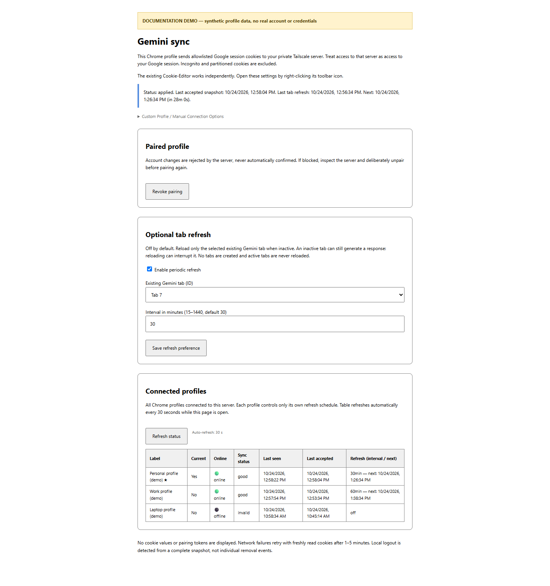
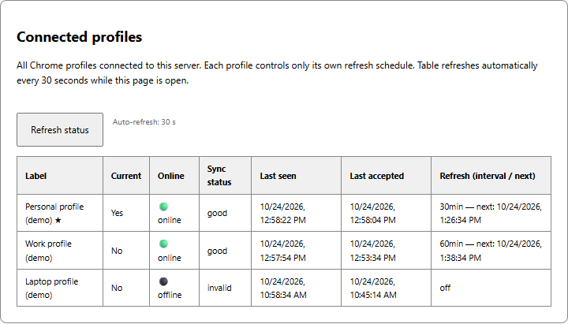

# Gemini Web Chrome Sync

Chrome extension and private receiver for synchronizing an explicitly authorized Gemini browser session to a self-hosted Gemini Web backend, with optional 9router integration.

> Experimental, unofficial integration. Session validity does not guarantee model availability. Google can require login/MFA or restrict access. This project does not bypass account verification or promise protection from account restrictions. Review Google's terms before use.

## Components

- **Chrome extension:** Cookie-Editor fork with allowlisted Google/Gemini cookie monitoring, automatic snapshots, durable retries, optional inactive-tab refresh and cross-profile status.
- **Receiver:** Python 3.10+ standard library, device-scoped bearer authentication, single-use pairing, ordered snapshots, candidate validation and logout handling.
- **Backend patch:** `deploy/browser-source.patch` for `gemini-web2api-go` v4.23.0. `GEMINI_BROWSER_COOKIE_SOURCE=1` disables competing backend rotations/Set-Cookie merging and enables atomic disabled candidate imports.
- **9router integration:** OpenAI-compatible backend plus optional per-profile provider/model provisioning.

```text
Chrome profile A -> scoped token A -> private Tailscale receiver -> dedicated backend A -> 9router
Chrome profile B -> scoped token B -> private Tailscale receiver -> dedicated backend B -> 9router
```

Cookie values flow browser-to-server only. Server responses contain status, not cookie payloads. A connected profile can see status metadata for other configured profiles of the same operator; it cannot read their cookies or tokens.

## Screenshots

The following captures render the extension itself with **synthetic demonstration profiles**. They do not contain real account data and are not evidence of a live Google login.





## Documentation

| Document | What it covers |
|---|---|
| [Product requirements](docs/PRD.md) | Users, scope, requirements, acceptance criteria and limitations |
| [Architecture](docs/ARCHITECTURE.md) | Trust boundaries, data flow, account isolation and backend patch |
| [Tech stack](docs/TECH-STACK.md) | Browser APIs, runtime, storage, dependencies and tooling |
| [Usage guide](docs/USAGE.md) | Install, pair/import, refresh scheduling and reading profile status |
| [HTTP API](docs/API.md) | Authentication, request/response examples, ordering and errors |
| [Operations](docs/OPERATIONS.md) | Deployment, diagnosis, recovery, backups and rollback |
| [Output contracts](docs/OUTPUT-CONTRACTS.md) | Optional default, JSON and code-only response modes |
| [Response adapter](docs/RESPONSE-ADAPTER.md) | Validation findings, tested patches and remaining limitations |
| [Contributing](CONTRIBUTING.md) | Development, tests and safe pull requests |
| [Security](SECURITY.md) | Credential handling and private-network requirements |

## Start here

1. Read [security guidance](SECURITY.md) and [server setup](server/README.md).
2. Deploy a dedicated Gemini backend per browser profile. Apply the supplied patch to upstream **v4.23.0**, build it and set `GEMINI_BROWSER_COOKIE_SOURCE=1`.
3. Create a private receiver configuration from `server/config.example.json`. Store real credentials outside this repository with mode `0600`.
4. Run the receiver behind **private Tailscale Serve HTTPS**, never Funnel:

   ```sh
   python3 server/cookie_sync.py --config /etc/cookie-sync/config.json --state /var/lib/cookie-sync serve
   tailscale serve --bg --https=8443 http://127.0.0.1:8787
   ```

5. Build the unpacked Chrome extension:

   ```sh
   npm ci --ignore-scripts
   npx grunt copy:chrome replace:chrome
   ```

   In `chrome://extensions`, enable Developer mode, choose **Load unpacked**, select `build/chrome`.
6. Right-click the extension toolbar icon, open **Gemini sync settings**, and pair using the private HTTPS address and a one-time code:

   ```sh
   python3 server/cookie_sync.py --config /etc/cookie-sync/config.json --state /var/lib/cookie-sync create-pairing personal-profile
   ```

7. Accept Chrome host permissions. Keep Chrome running. Cookie changes trigger automatic sending; server acknowledgement indicates successful application.

### One-click private installation

The public repository contains **no default token**. For a personal preconfigured package, create a device connection JSON privately with `endpoint`, `deviceId`, and `token`, then put it at `$HOME/.gemini-cookie-sync/main-profile.connection.json`. Run `deploy/package-chrome.ps1` to build your private package. That package contains your token: **do not publish or share it**, and do not install it in a different Chrome profile. Use separate device credentials and backend targets per profile.

### Direct Tailscale IP mode

HTTPS Serve is preferred. Direct HTTP accepts each user's canonical Tailscale IPv4 address in `100.64.0.0/10` on port `8787`; there is no IP belonging to the maintainer hardcoded as a destination. Set your own `http://YOUR_TAILSCALE_IP:8787` in your private connection configuration (or the manual pairing endpoint field). The extension requests permission for that exact host, not the whole range. `100.64.0.0/10` is an address range, **not a URL**. No network scanning or automatic server discovery is performed. Configure receiver `allowedHosts` accordingly and use:

```sh
python3 server/cookie_sync.py --config /etc/cookie-sync/config.json --state /var/lib/cookie-sync serve --bind YOUR_TAILSCALE_IP --port 8787
```

Only loopback or a canonical IPv4 in Tailscale's `100.64.0.0/10` range is accepted for binding. Never bind `0.0.0.0`. Direct HTTP has no additional TLS layer; Tailscale encrypts traffic between peers. Restrict tailnet ACLs and keep bearer authentication enabled. Deployment scripts under `deploy/` are operator examples, not a universal installer: review paths, ports, container names and rollback steps first.

## Features and limits

- Five-second change debounce; periodic reconciliation; retry backoff of 1–5 minutes.
- Singleflight uploads and persisted sequence metadata prevent stale replacement.
- One browser profile per backend target; no implicit account fallback.
- Optional refresh interval 15–1440 minutes, default 30, selected inactive Gemini tab only. An inactive tab may still be generating; refresh can interrupt it.
- Profile table distinguishes browser online status from session validity.
- No background chat prompts to keep sessions alive.
- Chrome closed/asleep or disconnected from Tailscale means no live synchronization.
- The conservative account guard pins a session-cookie hash, not a stable Google identity. A legitimate base-session rotation may require operator intervention.
- Google can return an error message with HTTP 200. Inspect actual response content when testing models.

## Tests

```sh
npm test
npm run lint
python -m unittest discover -s server -p 'test*.py'
node --test test/provision-sync.test.cjs
```

Optional browser tests require Python Playwright and Chromium:

```sh
python -m pip install playwright
python -m playwright install chromium
# After packaging an unpacked extension:
python deploy/browser-smoke.py
```

`deploy/remote-e2e.py` is an operator-run integration harness with synthetic credentials and an isolated remote fixture. Never configure that fixture as a real account backend. It tests actual network transport; its test manifest pregrants host permissions and does not test interactive permission dialogs. Existing upstream DevTools tests emit diagnostic warnings while passing.

## Repository map

```text
sync/                    Chrome sync worker, settings UI and validation
server/                  Python receiver, configuration example and tests
test/                    Extension and upstream editor regression tests
deploy/                  Operator scripts, backend patch and browser test harnesses
docs/                    PRD, architecture, API, usage and operations
docs/images/             Synthetic-data screenshots rendered with Playwright
interface/, icons/       Original Cookie-Editor interface and assets
```

## Verification and known gaps

At publication, the source test suites passed **61 JavaScript tests, 36 receiver tests, and 2 provisioning tests**; ESLint and the Chrome Grunt build passed. The original private deployment also exercised a synthetic remote fixture over Tailscale with Playwright: activation, cookie-change sync, profile status, refresh, and logout. That harness pregranted permissions and accelerated its refresh alarm; it did not verify the native permission dialog or real Google model availability.

There is no GitHub Actions workflow in this initial publication because the publishing token lacks `workflow` scope. Run tests locally before deployment. The backend patch must be applied to its documented upstream version. Models exposed by a third-party backend are not a guarantee of account entitlement or response quality.

To regenerate documentation screenshots after building Chrome:

```sh
python deploy/docs-screenshots.py
```

The screenshot helper mocks displayed profile metadata; it never imports real sessions or device tokens.

## Upstream and licensing

- [Cookie-Editor](https://github.com/Moustachauve/cookie-editor), copyright its respective contributors, **GPL-3.0-only**. See [LICENSE](LICENSE), [upstream README](UPSTREAM-README.md).
- [gemini-web2api-go](https://github.com/zexadev/gemini-web2api-go), **MIT**; this repository distributes a patch, not upstream binaries. Preserve upstream notices when distributing a patched backend.
- This fork is unofficial and is not affiliated with Google, Cookie-Editor maintainers, or 9router maintainers.
