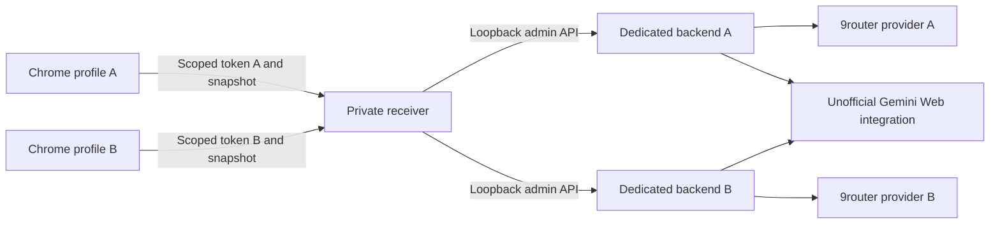
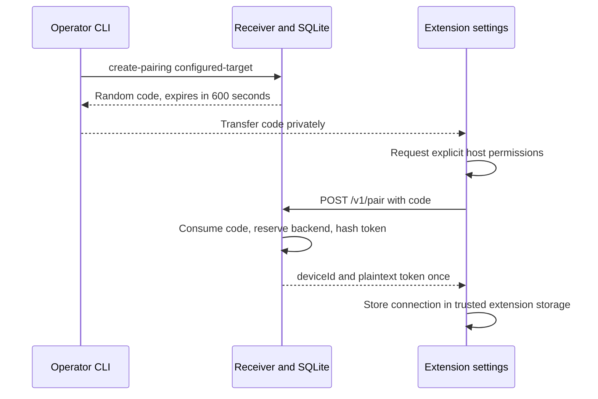

# Architecture

## System context



Each backend must belong exclusively to one profile: rotation deletes **all previous cookie rows** on the target. Merely naming two targets differently does not isolate them. Configuration requires distinct loopback ports; operators must also ensure those ports do not alias the same backend/database.

## Components and responsibilities

| Component | Source | Responsibility |
| --- | --- | --- |
| Extension worker | `sync/worker.js` | Cookie events, serialized uploads, persistent sequence/hash metadata, alarms, heartbeat, optional tab refresh |
| Validation helpers | `sync/helpers.js` | Endpoint and cookie allowlists, snapshot normalization, refresh bounds, profile response sanitization |
| Settings page | `sync/settings.html`, `sync/settings.js` | User-gesture permissions, pairing/import, refresh selection, profile-status table |
| Receiver | `server/cookie_sync.py` | Pairing, token authentication, ordering, durable metadata, backend adaptation, status APIs |
| Patched backend | `deploy/browser-source.patch` | Browser-source mode and atomic disabled candidate import for upstream v4.23.0 |
| Deployment helpers | `deploy/` | Operator-reviewed packaging, backend build/activation, provisioning, contract and transport tests |
| Optional router | External 9router | Separate OpenAI-compatible providers for dedicated backends |

The upstream Cookie-Editor UI remains part of the extension. Sync controls are opened through the extension toolbar context menu, not a separate standalone server UI.

## Pairing and trust boundaries



A code has 192 random bits and a device token 256 random bits. SQLite stores SHA-256 hashes, not plaintext tokens. Backend URL and credentials come only from local operator configuration. An authenticated browser cannot choose a different backend. Every non-revoked token may read **all registered non-revoked profile metadata** in the same deployment; this is an intentional same-operator boundary, not tenant isolation.

The first successfully applied session pins the SHA-256 hash of `__Secure-1PSID`. This is a conservative session-value guard, **not stable Google account identity**. A legitimate rotation may trigger `account_changed`. Revoked devices retain their backend reservation, so migration must use a new empty dedicated target rather than resetting bindings.

## Snapshot and backend lifecycle

```mermaid
sequenceDiagram
  participant C as Chrome cookies
  participant W as Service worker
  participant S as Receiver
  participant D as SQLite
  participant B as Dedicated backend
  C->>W: Allowlisted cookie change
  W->>W: Debounce, collect current store, hash snapshot
  W->>W: Persist sequence and pending hash; schedule retry
  W->>S: POST /v1/snapshot
  S->>S: Authenticate, validate, enforce order and session pin
  S->>D: Commit seen sequence/hash and in-flight marker
  S->>B: Import disabled candidate
  S->>B: Verify disabled; check candidate
  alt Valid candidate
    S->>B: Disable old rows; enable candidate; delete old rows
    S->>D: Commit applied sequence/hash and good status
    S-->>W: applied
  else Invalid candidate
    S->>B: Delete candidate; retain old rows
    S->>D: Record invalid and request sync
    S-->>W: invalid
  end
```

The worker serializes commands and uses a singleflight dirty loop for uploads. A retry re-reads browser cookies: identical content reuses the pending sequence; changed content gets a higher sequence. Cookie payloads are not persisted in a receiver recovery journal. Invalid snapshot hashes are suppressed in the worker until cookie content changes.

The receiver uses a global reentrant lock, SQLite IMMEDIATE transactions, `synchronous=FULL`, and a durable pre-network journal. A POSIX lifetime file lock prevents two serving processes from using the same state directory. These choices favor conservative ordering over throughput. Do not run another service/state directory or external importer against the same target.

Before activation, failures attempt to restore old enabled rows and delete the candidate. After activation, failed cleanup cannot restore deleted credentials and returns `backend_partial_failure`. A lost import response can leave a remote candidate. Exact retries reconcile all rows, but SQLite and the backend are not a distributed transaction: exactly-once mutation is not guaranteed. Unpatched backends may ignore disabled import and briefly activate a candidate; production deployments should use and validate the supplied patch.

Logout disables every row without deleting it. Revocation disables and verifies every row before invalidating the token. Failure can partially disable rows while leaving authorization intact for a retry.

## Scheduling and status

| Activity | Current behavior |
| --- | --- |
| Cookie debounce | Five-second timer plus one-minute alarm fallback |
| Status and heartbeat | One-minute status alarm; heartbeat is best effort |
| Reconciliation | Five-minute alarm |
| Retry delay | 1, 2, 4, then 5 minutes maximum |
| Backend live check | On eligible status requests, cached for 300 seconds |
| Profile connectivity | Online when last status/heartbeat was within 180 seconds |
| Profile table | Refreshes every 30 seconds while settings remain open |
| Optional tab refresh | 15–1440 minutes, default 30; selected inactive regular Gemini tab only |

Chrome alarms are subject to suspension and sleep. The server cannot command a tab refresh through heartbeat: `lastRefreshAt` and `nextRefreshAt` are client-reported epoch seconds, not execution guarantees. An inactive tab can still be generating and a reload can interrupt it. No background chat prompts are sent.

`good` means exactly one enabled backend row passed the cookie check; it does not mean every model works. `online` means recent receiver contact, not session validity. Profile-list reads do not perform fresh checks on every peer.

## Data placement and transport

- **Chrome:** original cookies, device token, endpoint, sequences/hashes, status and refresh preferences in local extension storage restricted to trusted contexts.
- **Receiver config:** backend admin tokens/API keys and fixed loopback origins; POSIX mode 0600 is required.
- **Receiver state:** `state.sqlite3` contains hashes, bindings, sequence journal and status/refresh metadata, not cookie values. Directory mode 0700 and database mode 0600 apply on POSIX.
- **Backend:** actual cookie credentials and backend database; protect separately.
- **Responses:** metadata only, except the one-time pairing token response. No cookie download endpoint exists.

Preferred transport is private Tailscale Serve HTTPS to loopback `127.0.0.1:8787`. The extension accepts HTTPS `*.ts.net` origins on default HTTPS or port 8443, without URL paths, credentials, queries or fragments. Direct HTTP accepts a user-selected canonical IPv4 address in `100.64.0.0/10` on port 8787; no source edit is required. The endpoint comes from manual pairing or private connection JSON, and permission requests target that exact host. There is no network scanning or automatic server discovery. Never use Funnel. See [Operations](OPERATIONS.md) and [API](API.md).
